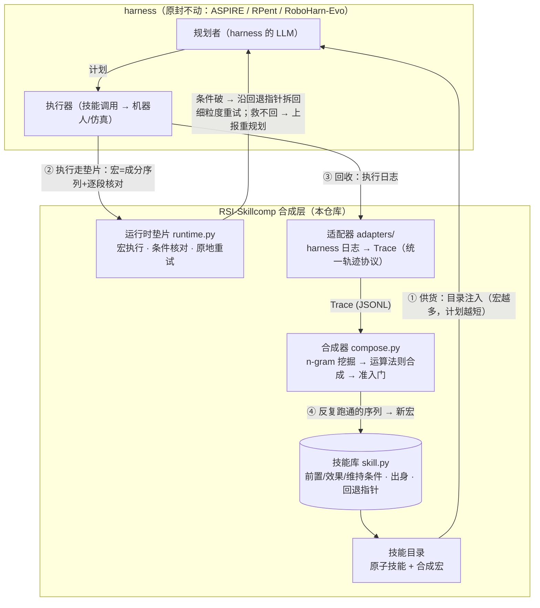

# RSI-Skillcomp

Symbolic skill composition layer for LLM robot harnesses: verified step
sequences are merged into bigger skills with pre/effect conditions, so
execution traces get shorter with experience; condition violations de-chunk
back to fine-grained steps.

合成层：把 harness 反复跑通的技能序列按运算法则并成带条件的大技能——
轨迹随经验变短；条件破了沿回退指针拆回细粒度。

## Pipeline

闭环含义：每多跑一轮，②③④①转一圈——**宏变多 → 计划变短 → 决策点和大模型调用变少**；
测量对象就是这条"越跑越快"曲线（成功率不得下降）。配对实验 = 同一 harness 断开/接通此环。

- 入口与规矩：[AGENTS.md](AGENTS.md)
- 轨迹协议：[doc/active/trace_format_v0.md](doc/active/trace_format_v0.md)
- 机制演示：`python3 examples/demo_curve.py`
- 测试：`python3 -m unittest discover -s tests`

## v0 范围声明（诚实版）

- 宏是接地的（绑定具体参数），参数泛化是 v1 的研究内容；
- 条件两档：declared（环境/算子自带）与 observed（从快照统计，近似）；
- 自带玩具环境只用于机制验证，其数字不构成任何实验主张；
- harness 适配器（ASPIRE / RPent / RoboHarn-Evo）尚未落地，接口见 `skillcomp/adapters/base.py`。
