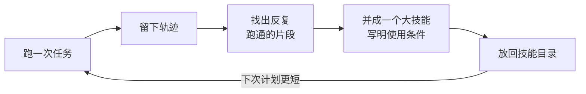
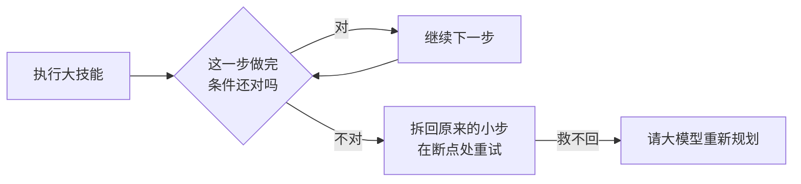

# RSI-Skillcomp

Symbolic skill composition layer for LLM robot harnesses: verified step
sequences are merged into bigger skills with pre/effect conditions, so
execution traces get shorter with experience; condition violations de-chunk
back to fine-grained steps.

合成层：把 harness 反复跑通的技能序列按运算法则并成带条件的大技能——
轨迹随经验变短；条件破了沿回退指针拆回细粒度。

## Pipeline

**图一：越用越快的循环**（我们这层做的全部事情）

1. **跑一次任务**：harness 照常干活，我们不碰它的大模型和技能；
2. **留下轨迹**：每一步调了什么技能、成没成，记成统一格式（`doc/active/trace_format_v0.md`）；
3. **找片段**：在多次成功的轨迹里，找反复以同样顺序出现、每次都跑通的连续几步；
4. **并成大技能**：把这几步合成一个新技能，并写清两行条件——什么时候能用、做完应该是什么样；
5. **放回目录**：下次做计划时，一个大技能顶过去的好几步——**计划变短，问大模型的次数变少**。

**图二：执行中跑偏了怎么救**（大技能自带的保险）

**怎么验证**：同一个 harness，断开图一的循环跑一遍、接上再跑一遍，对比四个数——
计划步数、大模型调用数、耗时（应该降），成功率（不得降）。

- 入口与规矩：[AGENTS.md](AGENTS.md)
- 轨迹协议：[doc/active/trace_format_v0.md](doc/active/trace_format_v0.md)
- 机制演示：`python3 examples/demo_curve.py`
- 测试：`python3 -m unittest discover -s tests`

## v0 范围声明（诚实版）

- 宏是接地的（绑定具体参数），参数泛化是 v1 的研究内容；
- 条件两档：declared（环境/算子自带）与 observed（从快照统计，近似）；
- 自带玩具环境只用于机制验证，其数字不构成任何实验主张；
- harness 适配器（ASPIRE / RPent / RoboHarn-Evo）尚未落地，接口见 `skillcomp/adapters/base.py`。
