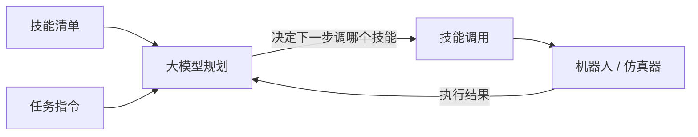
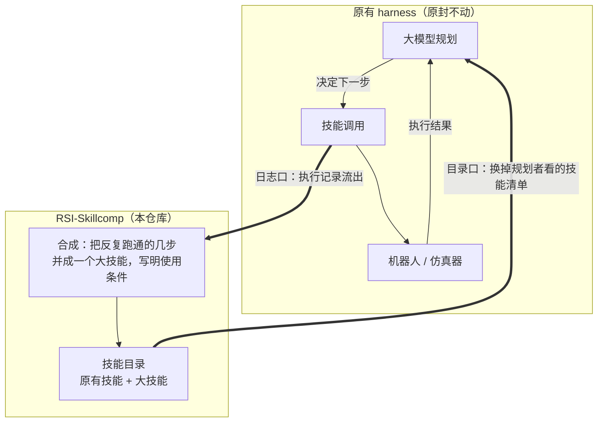
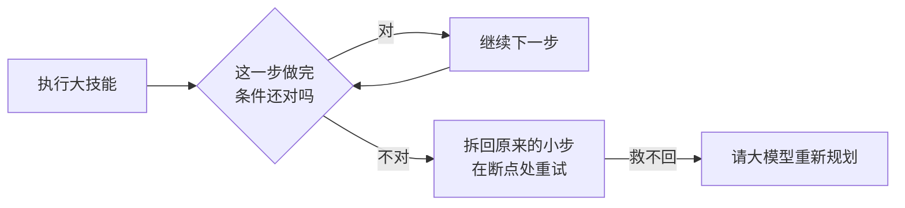

# RSI-Skillcomp

A plug-in layer for LLM robot harnesses. It watches which step sequences keep
succeeding, merges them into bigger skills with explicit use-conditions, and
hands those back to the planner. Plans get shorter as experience accumulates;
if a condition breaks mid-run, the big skill falls back to its original small
steps.

这是一个外挂层，不是一个新 harness。它观察哪些步骤序列反复跑通，把它们合并成
"带使用条件的大技能"，再交还给规划者。经验越多、计划越短；执行中条件不满足时，
大技能会拆回原来的小步骤重试。

## Pipeline

**图一：原有的 harness 长什么样**（我们不改动它的任何部分）

市面上的 harness（ASPIRE、RPent、RoboHarn-Evo……）内部结构不同，但对外都是同一副骨架——三个零件转一个圈：

- **大模型规划**：看着任务和技能清单，决定下一步调哪个技能；
- **技能调用 → 机器人**：真正动手的部分；
- **执行结果回到大模型**：成了走下一步，败了重新想。

各家的差别只在"大模型怎么用技能"：ASPIRE 是写程序调原语，RPent 是现场写代码，RoboHarn-Evo 是把知识检索进上下文。共同点有两个：**每一步决定都要问大模型**；**跑完的经验要么丢掉、要么塞回上下文（越塞越贵）**。

**图二：RSI-Skillcomp 接在哪**（只接两个口，虚线框内是我们）

- **目录口**：规划者原来看的"技能清单"换成我们的"技能目录"，内容多了合成出的大技能。一个大技能顶过去好几步，所以计划自动变短，问大模型的次数自动变少；
- **日志口**：每跑完一次，执行日志被翻译成统一的轨迹格式（`doc/active/trace_format_v0.md`）流进来，作为合成的原料；
- 除这两个口之外什么都不碰：不改大模型、不改技能的实现、不改评测。

**图三：执行中跑偏了怎么救**（大技能自带的保险）

**怎么验证**：同一个 harness，不接这层跑一遍、接上再跑一遍，对比四个数——
计划步数、大模型调用数、耗时（应该降），成功率（不得降）。

- 入口与规矩：[AGENTS.md](AGENTS.md)
- 轨迹协议：[doc/active/trace_format_v0.md](doc/active/trace_format_v0.md)
- 测试：`python -m pytest tests/`（33 个单测，不需要 GPU）

## 现状（2026-10-25，数字出处见 scoreboard.md）

已经在真仿真上验证过的：

- ASPIRE 适配器落地：真实运行日志 → 统一轨迹格式，字段逐项对过账；
- 从 25 条真实轨迹里挖出两个大技能（抓取、放置），在没见过的 5 个布局上
  **5/5 完成整个任务**，成败由基准自带的检查器判定；整个任务的程序正文从
  约 17 条语句缩到 2 次大技能调用；
- 把技能目录交给 harness 的规划 agent 后，它自愿采用大技能，采用时程序从
  54 次调用缩到 6–14 次（配对实验，同任务同种子）。

已经写好、还没接成闭环的：

- 技能库是追加式版本化的：新版本和旧版本并存，旧版本永不被改写（防遗忘
  靠这个架构性质，不靠训练技巧）；
- 测量三件套：每技能的冻结评测组、逐轮分数记录、失败档案（含失败归因三类：
  技能自身的问题 / 超出技能适用范围 / 规划失误）；
- 三选一裁决器（规则版）：根据失败档案决定"重试 / 继续改这个技能 / 拆分出
  新技能"，判定规则在跑实验前写死。

诚实的范围声明：

- 大技能目前绑定具体参数，参数泛化是下一阶段的研究内容；
- 自带的玩具环境只用于机制单测，它产生的数字不构成任何实验主张；
- VLA 阶段（技能 = 共享底座 + LoRA）只定了接口和选型（官方 pi05_base），
  训练部分尚未开始。
