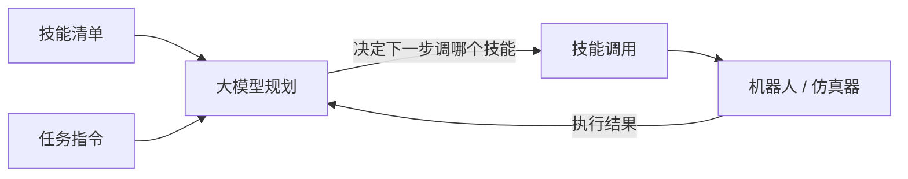
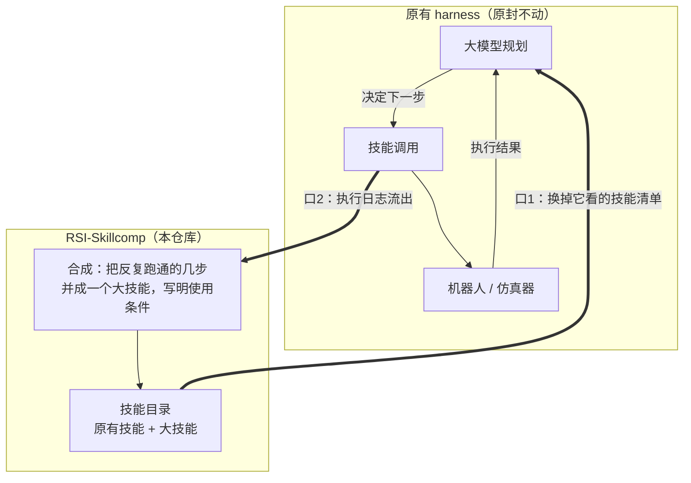
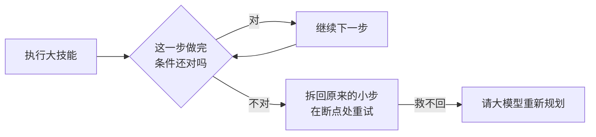

# RSI-Skillcomp

Symbolic skill composition layer for LLM robot harnesses: verified step
sequences are merged into bigger skills with pre/effect conditions, so
execution traces get shorter with experience; condition violations de-chunk
back to fine-grained steps.

合成层：把 harness 反复跑通的技能序列按运算法则并成带条件的大技能——
轨迹随经验变短；条件破了沿回退指针拆回细粒度。

## Pipeline

**图一：原有的 harness 长什么样**（我们不改动它的任何部分）

市面上的 harness（ASPIRE、RPent、RoboHarn-Evo……）内部结构不同，但对外都是同一副骨架——三个零件转一个圈：

- **大模型规划**：看着任务和技能清单，决定下一步调哪个技能；
- **技能调用 → 机器人**：真正动手的部分；
- **执行结果回到大模型**：成了走下一步，败了重新想。

各家的差别只在"大模型怎么用技能"：ASPIRE 是写程序调原语，RPent 是现场写代码，RoboHarn-Evo 是把知识检索进上下文。共同点是两个：**每一步决定都要问大模型**；**跑完的经验要么丢掉、要么塞回上下文（越塞越贵）**。

**图二：RSI-Skillcomp 接在哪**（只占两个口，虚线框内是我们）

- **口 1（清单口）**：规划者原来看的"技能清单"换成我们的"技能目录"——内容多了合成出的大技能。一个大技能顶过去好几步，**计划自动变短，问大模型的次数自动变少**；
- **口 2（日志口）**：每跑完一次，执行日志翻译成统一轨迹格式（`doc/active/trace_format_v0.md`）流进来，喂给合成；
- 除这两个口外什么都不碰：不改大模型、不改技能的实现、不改评测。

**图三：执行中跑偏了怎么救**（大技能自带的保险）

**怎么验证**：同一个 harness，断开图一的循环跑一遍、接上再跑一遍，对比四个数——
计划步数、大模型调用数、耗时（应该降），成功率（不得降）。

- 入口与规矩：[AGENTS.md](AGENTS.md)
- 轨迹协议：[doc/active/trace_format_v0.md](doc/active/trace_format_v0.md)
- 机制演示：`python3 examples/demo_curve.py`
- 测试：`python3 -m unittest discover -s tests`

## v0 范围声明（诚实版）

- 宏是接地的（绑定具体参数），参数泛化是 v1 的研究内容；
- 条件两档：declared（环境/算子自带）与 observed（从快照统计，近似）；
- 自带玩具环境只用于机制验证，其数字不构成任何实验主张；
- harness 适配器（ASPIRE / RPent / RoboHarn-Evo）尚未落地，接口见 `skillcomp/adapters/base.py`。
